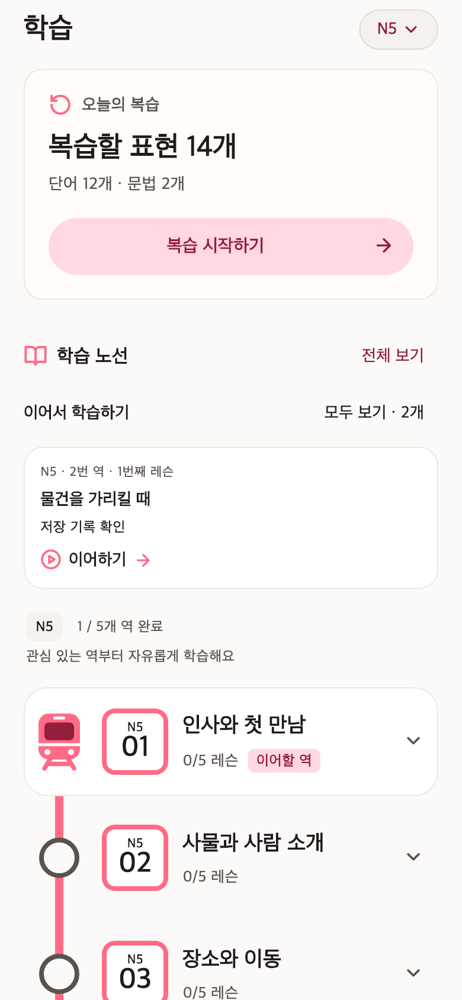
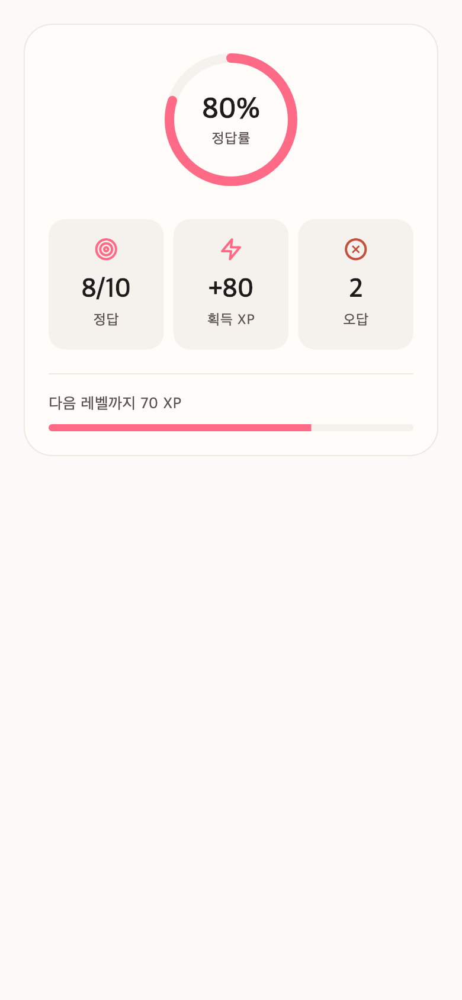

# 최신 앱을 설치했는데 지하철 학습 화면이 사라졌다

사건·조사 기준일: 2026-10-28. 문서 최종 정리: 2026-10-30.

2026년 10월 28일, 일본어 학습 앱 HaruKoto에 대화 전체 듣기와 저장 레슨 이어하기 개선을 반영하던 중 사용자가 물었다.

> 원래 레슨 화면은 지하철 역처럼 되어 있지 않았어?

기억의 차이가 아니었다. 사용자가 선택한 화면은 핑크색 노선, 정사각형 역 번호판, 추천 위치를 표시하는 열차가 있는 구성이었다. 실제 아이폰에는 원형 번호와 진행률 막대가 있는 일반 챕터 목록이 표시되고 있었다.

이 글은 확인한 사실과 소스 통합의 누락, 복구 과정에서 다른 기능을 잃지 않기 위해 바꾼 검증 기준을 기록한다. 파일이 동일하다는 검사와 사용자가 쓰던 기능을 보존했다는 검사가 서로 다른 질문이었다.

## 화면이 달라진 경로

원래 작업 폴더에는 지하철 UI가 그대로 있었다. `LessonChapterList`는 소스 플래그가 켜지면 `LessonStationList`를, 꺼지면 기존 목록을 선택했다. 플래그도 `true`였다. 노선 색상과 역·열차 위젯, 대체 목록, 관련 테스트는 미추적 파일로 남아 있었다.

반면 후속 작업에 사용한 최신 `main`에는 이 파일들이 없었다. 원본 폴더는 오래된 커밋 위에 여러 작업의 미커밋 변경이 쌓인 상태였고, 격리한 작업 트리는 커밋된 `main`을 기준으로 시작했다. 새 기능을 병합한 뒤 그 작업 트리에서 아이폰 앱을 빌드하면, 새 기능과 함께 원래 `main`의 일반 챕터 목록이 들어갔다.

원본 파일을 지우거나 디자인을 되돌린 PR은 확인되지 않았다. 원본에 보존된 승인 디자인이 배포할 소스에 포함되지 않은 통합 누락이었다. 후속 빌드를 준비하면서 기존 설치본에 포함된 로컬 디자인을 다시 대조했어야 했다.

| 확인한 시점               | 기록                                                                                                |
| ------------------------- | --------------------------------------------------------------------------------------------------- |
| 9월 29일                  | 노선도 구현·검증 기록. 원본 코드와 테스트가 현재도 남아 있음                                        |
| 10월 28일 오전 9시 46분경 | PR #197의 전체 듣기 반영 과정에서 노선도 없는 main 기준 빌드의 아이폰 설치 성공 receipt 확인        |
| 같은 날 낮 12시 57분      | PR #199가 이어하기 카드·전체 보기·최근 학습순을 반영. 챕터 목록을 그리는 핵심 세 파일의 변경은 없음 |
| 이후 조사                 | 현재 일반 목록 코드가 5월 7일 코드와 동일하고, 원본 노선도는 커밋 이력 밖에 있음을 대조             |

오전 9시 46분은 설치 receipt의 생성 시각을 기준으로 한 확인 지점이다. 화면이 최초로 바뀌는 순간을 촬영한 기록은 아니므로, 실제 최초 회귀가 이보다 앞섰는지까지 단정하지 않는다.

## 통과한 검사가 놓친 것

당시 빌드 검사는 엄격했다. 병합 커밋과 모바일 파일 수백 개의 바이트가 같은지, 서명이 유효한지, 앱 식별자와 키체인 권한이 유지되는지 확인했다. 로그인과 저장 위치, 전체 듣기도 점검했다.

그런데 비교 기준이 커밋된 `main` 하나였다. `main`에 포함되지 않은 승인 디자인은 이 검사에 등장하지 않았다. 모든 파일이 `main`과 일치한다는 결과는 정확했지만, 그 결과로 기존 사용자 경험까지 보존했다고 판단한 것이 문제였다.

시각 회귀를 막아야 할 노선도 테스트도 원본의 미추적 파일에 있었다. 최신 CI는 자신이 알고 있는 일반 챕터 화면을 정상으로 검사했다. 테스트 수가 늘고 모두 통과해도, 유지해야 할 기능이 테스트와 빌드 입력 양쪽에 없으면 그 기능의 소실은 잡히지 않는다.

앞으로는 두 기준을 함께 확인해야 한다.

1. **검증할 소스와 빌드가 일치하는가.** 커밋·파일 지문·서명·환경을 연결한다.
2. **사용자에게 이미 제공한 기능이 그 소스에 있는가.** 승인된 기능 목록과 실제 위젯의 표시·동작을 검사한다.

노선도라면 단순 파일 존재보다 ‘기본 화면에 열차와 정사각형 역이 표시되고, 뒤쪽 역을 열어도 앞의 역이 완료 처리되지 않으며, 새 이어하기 카드와 함께 동작한다’는 검증이 필요하다.

## 원본을 통째로 복사하지 않은 이유

원본에는 노선도 외에도 연속 학습일, 결과 화면, 오류 처리, 서버 수정, 운영 문서와 디자인 자료가 섞여 있었다. 그동안 여러 수정이 별도 PR로 이미 통합됐고, 최신 `main`에만 있는 개선도 생겼다.

따라서 원본을 최신 소스 위에 덮으면 다른 회귀를 만들 수 있었다. 실제로 원본의 생성된 API 타입에는 추가 제안 필드가 있는 동시에 최신 ‘이번 퀴즈의 오답 복습’ 계약이 없었다. 그 파일을 그대로 옮기는 방식으로는 기존 기능을 보존할 수 없다.

오래된 index도 주의해야 했다. 원본에서는 미추적 상태지만 최신 `main`에는 이미 추적되는 파일을 `git diff`만으로 비교하면 삭제처럼 보이는 항목이 나온다. 실제 디스크에는 파일이 있으므로 이를 곧바로 삭제나 누락으로 세면 안 된다.

이번에는 원본 HEAD, 원본의 실제 파일, 최신 `main`의 세 기준을 비교했다. 추적 변경과 미추적 파일을 함께 수집하고 Git blob·실행 모드로 먼저 분류한 뒤, 서로 다른 파일은 의미를 읽어 판단했다. 비밀 파일·환경 값·생성 산출물은 조사 목록에서 제외했다.

초기 목록은 446개 후보였다. 96개는 바이트와 모드가 이미 최신 `main`과 같았다. 80개는 의미 비교가 필요했고, 270개는 로컬 전용 후보였다. 마지막 수치에는 문서·디자인 자산·운영 도구가 많이 포함돼 있어, 이를 모두 ‘배포 기능 270개가 사라졌다’고 해석하지 않았다.

## 복구의 단위

노선도는 표시를 담당하는 위젯·색상·선택기와 주변 학습 화면의 승인된 표현을 현재 코드에 연결한다. 최근 이어하기 카드 한 개, 전체 목록, 실제 학습 시각에 따른 정렬, 대화 전체 듣기와 저장 상태 복원은 유지한다. 과거 화면 파일을 되돌리는 방식 대신 현재 호출 경계에 노선도를 다시 붙인다.

기존 규칙도 보존한다. 노선은 커리큘럼 순서이고 완료는 역마다 독립적이다. 뒤의 챕터를 먼저 학습해도 앞의 챕터가 완료된 것처럼 선을 채우지 않는다. 열차는 추천 위치를 나타내며 최근 활동 기록을 대신하지 않는다. 실제 최근 학습순은 저장 레슨 목록의 별도 정보로 다룬다.

다른 후보는 모바일, 서버, 웹·공유 패키지와 문서로 나눠 점검한다. 이미 통합된 수정과 아직 승인되지 않은 제안, 실제 빠진 동작을 구분한다. API·DB 구조·기존 복습 기한이 필요한 변경은 표시 복구에 묶어 적용하지 않는다.

표시 외의 누락도 있었다. 결과의 정답·XP·오답 카드는 가운데 XP 카드에만 레벨 진행 정보가 붙어 높이가 달랐고, 과한 색종이와 콤보음도 남아 있었다. 타일 높이를 맞추고 레벨 진행을 별도 영역으로 옮겼다. 정답·오답 효과만 공통 경로로 재생하도록 복구했다.

매칭 퀴즈에서는 선택지용 ID를 문항 ID로 바꾸는 변환이 현재 서버 계약과 맞지 않았다. 서버가 제공하는 canonical `questions.questionId`를 유지하고 표시용 단어·뜻만 보완했다. 답안 저장은 최신 main의 병렬 처리와 서버 잠금·멱등성을 유지하면서 완료 전 저장 확인, 실패 후 재시도와 이전 세션의 늦은 응답을 무시하는 보호만 보강했다.

복구 화면은 다음처럼 정리했다. 이미지는 **합성 데이터로 렌더한 Flutter 위젯**이며 실제 사용자 계정이나 아이폰 화면이 아니다. 앱 색상 토큰과 시스템 한국어 대체 폰트를 사용했다.

어두운 모드도 같은 노선 구조로 검사했다. [어두운 모드 렌더](assets/2026-10-28-subway-restoration/lesson-route-dark.png)에서 이를 확인할 수 있다.

## 검증과 남은 범위

복구 검증과 후보별 판단은 [실행 계획·누락 점검 기록](../operations/plans/mobile-local-changes-restoration-2026-10-28.md)에 연결한다. 조사 후보 446개는 전부 분류했고 원본의 소스·자료 변경은 없었다. [파일별 분류표](../operations/plans/mobile-local-changes-audit-2026-10-28.tsv)는 최초 누락 여부와 판단 근거를 남긴다. 문서·디자인 이미지 수를 실제 제품 결함 수와 섞지 않는다.

1차 모바일 복구 소스는 포맷 검사와 정적 분석을 통과했고 **전체 Flutter 테스트 824개가 통과**했다. 기본 노선도와 fallback, 첫 추천역의 열차, 자유 순서 학습, 큰 글자·다크 모드, 최근 이어하기 카드와 전체 목록, 매칭 답안 ID, 완료 저장 실패 재시도와 세션 전환을 검사했다. focused 검사끼리는 겹치는 사례가 있으므로 합산하지 않았다.

별도로 발견한 KST 연속 학습일 계산은 API와 웹의 날짜 수정으로 분리했다. 저장된 UTC 시각과 한국 학습 날짜를 같은 기준으로 비교하고, 같은 날이나 오래된 요청에서 기존 카운터를 보존한다. 처음 날짜 수정만 한 단계에서는 API 1039개가 통과했고, 아래 추가 계약을 포함한 최종 서버에서는 **1056개가 통과**했다. 필수 PostgreSQL 85개는 skip 없이 통과했으며 기존 admin fixture 13개는 skip으로 구분했다. 과거 기록을 일괄 재계산한 작업은 아니다.

달력의 활동 판정도 따로 다뤘다. 원래 history 응답의 숫자 필드만 보면 가나·문법처럼 내부 집계에는 있지만 노출되지 않은 활동을 놓칠 수 있었다. API 추가 구체안을 승인받은 뒤 기존 집계에서 계산한 `records[].hasStudied` 불리언을 추가하고, 모바일은 명시적인 값이 있으면 이를 우선하며 구 응답은 기존 숫자 계산으로 지원하도록 연결한다. 시작만 해 만든 일별 행 자체를 출석으로 인정하거나 XP를 조작하지 않는다. 최신 OpenAPI·생성 타입을 재생성해 기존 103개 경로·오답 복습 계약이 그대로인지 확인했고, 직접 타입 소비자인 관리자 앱의 테스트·빌드도 통과했다.

이 소비자까지 연결한 **최종 모바일 전체 테스트는 889개가 통과**했다. 새 달력·연속일·새로고침 회귀 65개를 더했으며, KST 소비자 26개는 UTC·서울·LA에서 각각 통과했다. 포맷·정적 분석과 독립 검토도 완료했다. 원본을 통째로 덮지 않고도 최근 이어하기·전체 듣기와 이전에 승인된 화면을 함께 보존할 수 있음을 소스와 회귀로 확인한 단계다.

모든 로컬 변경을 복구했다고 주장하지도 않는다. 이 불리언은 기존 집계에서 확인되는 활동이며 **영속 출석 마커 신설은 별도 DB 설계 판단이 필요**하다. Android 시작·알림 변경도 release 검증 대상으로 남겼다. 부분 진행한 매칭 퀴즈의 서버 재개 지원은 이전부터 불완전하므로 이번 ID 수정으로 모든 유형의 이어 풀기까지 실증했다고 확대하지 않는다. 전체 음원 청취 검수도 계속 별도 항목이다.

아이폰에는 노선도가 빠진 준비 빌드를 추가 설치하지 않았다. 앱 삭제·로그아웃·기록 초기화 없이 기존 저장 레슨의 위치만 증거로 남겼다. 화면 복구와 기능 회귀 검증이 끝난 뒤에도 설치·실기기 확인은 실제 수행한 단계로 별도 기록해야 한다.

이번 원인의 핵심은 격리된 작업 트리 자체의 문제가 아니었다. 격리 작업의 기준 커밋과 실제 제공된 제품 사이의 차이를 추적하지 못했다. 원본 변경을 디스크에 남겨두는 일에 더해, 승인된 기능을 커밋·테스트·빌드 입력까지 연결하는 절차가 필요했다.
