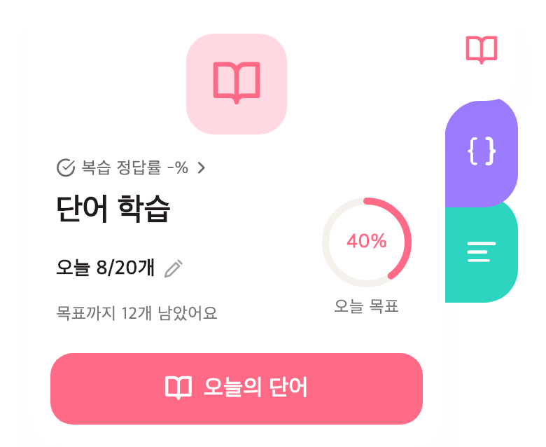
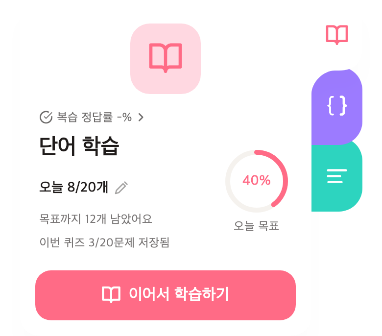

# 하루 목표 옆의 2%는 무엇을 뜻할까

작성일: 2026-10-30. 이 글은 소스 구현과 검증을 기록한 초안이다. 운영 앱 반영이나 실기기 검수가 끝났다는 의미는 아니다.

HaruKoto의 홈에는 ‘단어 학습’, ‘하루 목표 20개’, 그리고 작은 원형 진행률이 있었다. 그 링 아래의 이름은 ‘N5 숙련도’였다. 사용자는 이 숫자가 오늘 목표를 얼마나 채웠는지 보여주는 것이 더 자연스럽지 않느냐고 물었다.

문제는 숫자 자체보다 숫자 사이의 관계였다. 하루 목표 옆의 2%는 오늘 20개 중 얼마나 했는지처럼 보이지만 실제로는 N5 전체의 누적 숙련도였다. 미완료 퀴즈가 있으면 같은 링이 이번 퀴즈의 저장 답안 비율로 바뀌었다. 화면 하나에서 하루 목표·세션 진행·장기 숙련도가 교대로 같은 자리를 차지하고 있었다.

## 먼저 숫자의 역할을 나누기

홈 단어 카드의 링은 ‘오늘 목표’로 고정하기로 했다. 미완료 퀴즈는 ‘이번 퀴즈 3/20문제 저장됨’과 이어하기 진입으로 따로 보여준다. N5 숙련도 데이터와 통계는 유지한다. 목표를 바꾸는 버튼도 미완료 퀴즈 유무와 관계없이 사용할 수 있어야 했다.

오늘 8개를 풀고 목표가 20개라면 `오늘 8/20개`, `40%`, `목표까지 12개 남았어요`가 같은 사실을 말한다. 목표를 넘으면 실제 수치는 `24/20개`로 남기고 링만 100%로 제한한다. 정답률은 목표 달성과 다른 정보로 다룬다.

다음 이미지는 실제 Flutter 위젯을 합성 데이터로 렌더한 것이다. 실제 계정·서버·아이폰 화면이 아니며, 앱 색상 토큰과 로컬 Apple SD Gothic Neo·Lucide 폰트를 사용했다.

## 기존 이름만 믿고 계산하면 생기는 문제

서버의 `wordsStudied`는 오늘 풀어본 고유 단어 수가 아니었다. 완료한 일부 퀴즈 유형의 정답 수를 누적하는 값이었다. 같은 단어를 다른 세션에서 다시 맞히면 다시 올라가고, 진행 중인 퀴즈의 답안이나 오답은 인정하지 않았다. `goalProgress`는 단어 수 대신 XP 기반 비율이었다.

이 값을 재사용해 ‘오늘 배운 단어’라고 쓰면 학습자가 실제로 한 행동과 화면의 뜻이 달라진다. 특히 입문자가 문제를 풀었어도 많이 틀렸다는 이유로 목표가 거의 늘지 않는 경험을 만들 수 있었다.

이번에는 단어 퀴즈와 단어 복습에서 답안을 저장한 단어를 센다. 정답과 오답을 모두 포함하고, 같은 단어 ID는 하루에 한 번만 인정한다. 퀴즈를 끝내지 않았어도 저장한 답안은 포함한다. 레슨 카드 열람과 문법·가나·한자·듣기·문장 퀴즈는 이번 지표에 넣지 않았다. 범위를 넓히려면 먼저 어떤 행동을 인정할지 정의해야 한다.

## 답안 저장일과 한국 날짜를 맞추기

이 집계는 퀴즈 완료일이 아니라 답안을 저장한 날짜에 속한다. 어제 시작한 퀴즈라도 오늘 저장한 단어는 오늘 센다. 한국 자정 이상부터 다음 자정 미만까지의 명시적인 구간을 사용한다.

기존 DB 초기 스냅샷에는 timezone 없는 UTC timestamp가 있고 ORM의 새 테스트 저장 타입은 timezone-aware였다. 세션의 timezone에 의존한 비교를 하면 저장 형태에 따라 날짜가 달라질 수 있다. 두 저장 형태에서 같은 UTC 기준 구간을 비교하도록 했고, 실제 PostgreSQL의 세션 timezone을 서울과 LA로 바꿔 각각 자정의 양끝을 검사했다.

## 응답에 날짜까지 담은 이유

기존 대시보드 필드를 바꾸지 않고 `today.vocabularyGoal`에 `date`와 `answeredCount`를 추가했다. 목표 비율은 기존 사용자 설정값과 이 개수를 사용해 모바일에서 계산한다. 날짜를 함께 보내면 자정을 넘긴 오래된 응답이 새날의 진행률로 표시되는 것을 막을 수 있다.

새 객체가 없는 구 서버나 잘못된 응답, 조회 실패를 0%로 바꾸지 않는다. 아직 알 수 없다는 상태와 실제 0개를 구분한다. 이미 진행 중인 퀴즈의 저장 위치와 재시도 정책도 그대로 유지한다. 퀴즈를 중단하고 홈으로 돌아올 때는 새 단어 집계를 다시 조회한다.

## 추천 문항 수도 같은 기준으로

연결된 스마트 미리보기에서는 또 다른 집계를 사용하고 있었다. 단어뿐 아니라 문법 등 모든 답안 행을 오늘 진행량으로 세어 목표에서 빼는 방식이었다. 그 결과 홈 단어 목표는 0/10인데 문법을 먼저 풀었다는 이유로 다음 단어 학습은 1문제만 추천할 수 있었다.

이 기존 응답 필드의 의미 변경은 추가 구체안으로 사용자 승인을 받았다. 단어 미리보기만 새 고유 단어 집계를 공유하고 남은 목표를 기준으로 추천한다. 문법 추천과 복습 기한·추천 분배 알고리즘은 보존한다. 한국 날짜나 목표값을 바꾼 뒤에는 단어 미리보기도 다시 조회해 오래된 추천을 보여주지 않게 한다.

## 검증 기록과 남은 경계

정확한 계약·실행한 테스트·소비자 호환성과 적용 범위는 [구현 계획과 검증 기록](../operations/plans/daily-vocabulary-goal-2026-10-30.md)에 연결한다. 추가 PostgreSQL 회귀는 CI에서 없어지거나 skip되면 실패하도록 기존 필수 검사 목록에 포함한다.

기존 학습 기록을 새 기준으로 덮어쓰거나 XP·복습 기한·출석을 보정하지 않는다. 새 테이블·컬럼·권한·환경 설정도 필요하지 않았다. 기존 답안을 읽어 별도 의미의 수치를 제공하는 변경이다. 소스 테스트와 합성 화면 검토, 실제 운영 배포와 실기기 확인은 각각 수행한 단계로 구분해 기록한다.
