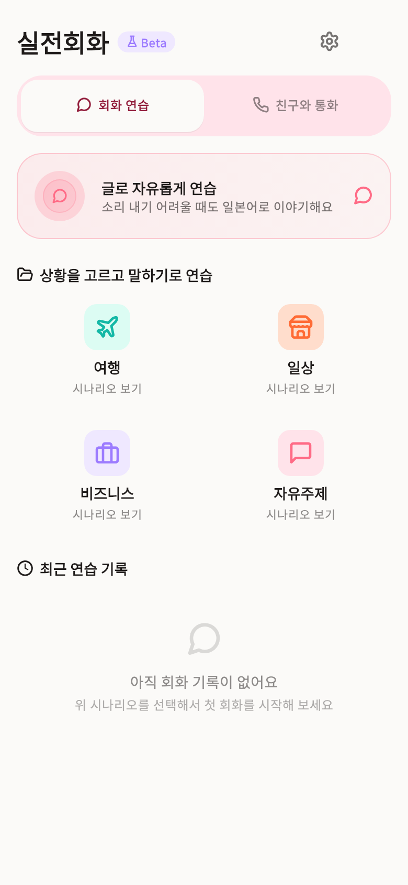
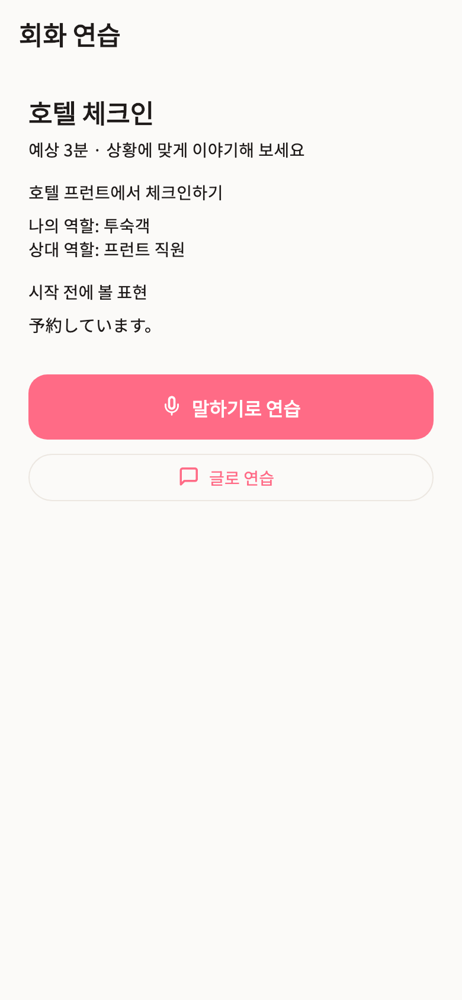
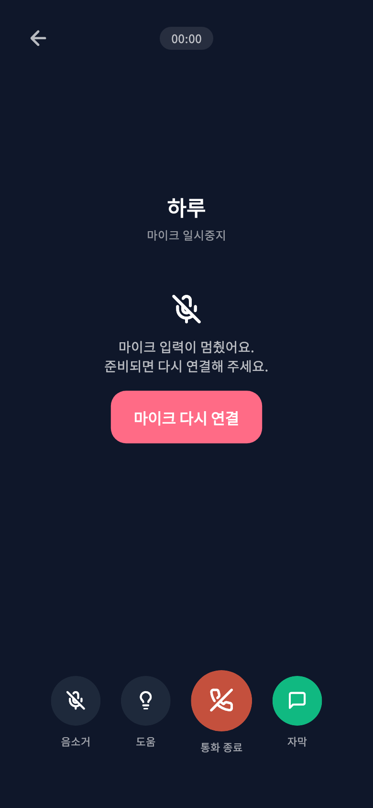
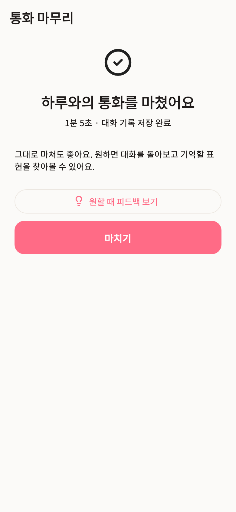

# 실전회화 경험 개선 통합

상태: 최신 운영 기준에 개선 통합·로컬 검증 완료 · 운영 미배포 · 2026-11-03

## 목적과 범위

사용자는 운영 API·웹의 Gemini Live 3.8 전환 이후 남아 있는 회화 화면·학습 흐름·오디오 복구 개선을 계속 진행하도록 요청했다. 기존 개발 작업을 새로 시작하지 않고, 현재 운영 기준 `198369f06bee7a22a43bf47c460887360c5e43da` 위에 회화 변경만 통합한다. 원래 작업 공간의 다른 미커밋 변경은 보존한다.

- 브랜치: `codex/conversation-experience-20261103`
- 통합 작업 공간: `/private/tmp/harukoto-conversation-release-20261103`
- 두 시작점: 회화 연습 / 친구와 통화. 마지막 선택을 기억한다.
- 연습: 상황 준비 → 음성 또는 글쓰기 → 도움 → 짧은 피드백 → 선택적인 표현 저장·자기 확인 연습.
- 친구: 상대 선택 → 전화 느낌의 대화 → 중립적인 종료·기록 → 원하는 경우에만 피드백.
- 복구: 새 토큰 재연결, 준비 완료 전 송신 차단, 마이크 중단 안내와 명시적인 재개, 늦게 끝난 비동기 작업의 다음 통화 간섭 방지.
- 기록: 시작 전에 통화 ID 확정, 저장과 분석 분리, 중복 보상·이용량 방지, 기존 개인 표현 메모 보존.

## 구현 순서

1. backend-agent가 최신 API의 기존 학습일 인정·보상 정책을 유지하며 회화 계약과 저장 경로를 통합한다.
2. mobile-agent가 화면·학습 흐름과 오디오 런타임을 파일 소유권에 따라 병렬 통합한다.
3. API 계약을 확정하고 생성 타입·모바일·웹 소비자의 호환성을 확인한다.
4. 좁은 회귀 검사 후 영향받는 전체 검사, 독립 PostgreSQL 검증, 모바일 빌드와 실제 위젯 화면을 확인한다.
5. 변경 범위와 남은 검증을 기록하고 검토 가능한 PR로 정리한다.

## 완료 기준

- 호텔 역할극과 친구 통화의 인사·도움·피드백 기본값이 각각 일관된다.
- 친구 통화의 종료나 과거 기록 열람이 자동으로 분석을 요청하지 않는다.
- 저장 실패·분석 실패·저장 성공을 구분하고 재시도해도 보상이 중복되지 않는다.
- 도움 패널과 오디오 중단에서 마이크 상태를 정확히 표시하며, 앱 복귀만으로 녹음을 다시 시작하지 않는다.
- 재연결·종료·다음 통화가 겹쳐도 이전 비동기 완료가 현재 통화를 바꾸지 않는다.
- API snapshot과 TypeScript·Dart 소비자가 일치하고, 최신 main의 다른 기능에 회귀가 없다.

## 별도로 남기는 범위

실제 마이크·청감·Bluetooth·전화 인터럽트·셀룰러 전환 검증은 사용자가 후속으로 분리했다. 자동 검사 결과를 해당 물리 검증의 통과로 표시하지 않는다.

첫 완성 범위에 포함되지 않은 자동 목표 판정, 자동 발음·재발화 채점, 간격 복습, 장기 기억, 자동 수신 전화, 백그라운드 통화, 즉시 재생 취소·자동 끼어들기는 이번에 추가하지 않는다. 새 DB 스키마·환경 계약·production dependency 없이 기존 구조로 통합한다.

모델 3.8의 운영 배포는 이미 완료됐다. 이 문서의 화면·런타임 개선은 별도 기능 변경이며, 통합·검증 상태와 운영 배포 상태를 구분한다. 새로운 모바일은 API의 `/live-session` 계약을 사용하므로 기능 출시 순서는 API → 모바일이다.

## 결과

### 통합 과정에서 보완한 경계

- 최신 운영 코드의 user → conversation 잠금 순서, 학습일 인정과 보상 정책을 유지한다. 새 `/live-session`도 기존 쓰기 중지 정책의 대상에 추가하고 중지 플래그는 바꾸지 않는다.
- 분석 문맥 조회나 결과 저장에서 오류가 나도 이미 완료된 대화 저장을 실패로 오인하지 않게 한다. 저장 ID와 분석 실패를 구분해 반환한다.
- AI 인사만 남은 통화가 나중에 완료 업적이나 캐릭터 통화 수에 들어가지 않도록 실제 사용자 발화가 있는지 확인한다. 잘못된 과거 JSON 형식도 발화로 변환하지 않는다. 과거 기록에는 개별 연결 시간이 없으므로 누적 통화 수를 15초 이상 보상 조건과 완전히 동일하다고 표현하지 않는다.
- 네이티브 녹음 종료가 실패하거나 지연돼도 확보한 전사를 저장 흐름으로 넘긴다. 정리는 캡처한 이전 통화 서비스에 계속 시도한다.
- PCM 출력의 setup/feed/release는 소유권을 확인한다. 이전 정리 작업이 새 출력에 영향을 주지 않으며, native 작업이 미완료인 동안 다음 setup을 시작하지 않는다. 제한시간은 호출자의 대기를 끝낼 뿐 진행 중인 native 작업을 취소했다고 간주하지 않는다.
- 녹음 권한 확인이나 `startStream`이 늦게 완료돼도 종료된 통화가 입력을 다시 시작하지 않게 하고, 늦게 만들어진 스트림을 정리한다.
- 모바일에서 분석 없이 저장한 음성 기록을 웹에서도 원문으로 볼 수 있게 한다. 없는 점수나 분석 결과를 만들어 표시하거나 기록을 여는 것만으로 분석하지 않는다.
- 단어장 행 ID는 어휘 음성 ID가 아니므로 잘못된 음성 요청 버튼을 제거한다. 저장 표현의 읽기·메모·삭제·출처는 유지하고 임의의 TTS 요청을 추가하지 않는다.

### 검증 기록

실제 PostgreSQL에서 통화 ID 중복 준비, 응답 유실, 동시 종료, 분석 중 잠금 해제, 저장 실패 원복, 개인 표현 보존, 사용자 발화 존재 여부 등 23개 검사를 통과했다. 이 23개를 CI의 실행 필수 목록에도 추가해 기존 290개와 함께 총 313개가 누락·skip 없이 통과해야 한다. CI guard 자체 검사 10개도 통과했다.

첫 PR CI에서 C 로케일 PostgreSQL의 `\S`가 일본어 전각 공백을 발화로 집계하는 차이를 발견했다. 같은 C 로케일에서 실패를 재현한 후 Python `str.strip()`과 일치하는 공백 29개를 명시적으로 지정했다. JSONPath 문자열은 JSON 인코더로 처리한다. 기존 회귀를 약화하지 않고 공백 전체와 공백으로 감싼 실제 일본어까지 검사했으며, C 로케일·기본 Docker PostgreSQL 각각 같은 23개 검사를 모두 통과했다.

| 로컬 검사 | 결과 |
|---|---|
| API 전체 | 1,324 passed / 326 skipped — 기존 290개·신규 23개 PostgreSQL 및 기존 제외 13개 |
| 신규 PostgreSQL 별도 실행 | 23 passed, 일회용 로컬 Docker DB 사용 후 삭제 |
| API Ruff·format / Mypy | 335개 파일 / 190개 소스 통과 |
| 모바일 계약 검사 | Dio 경로 62개·모델 5개 clean |
| 공유 타입 생성·lint·typecheck / admin typecheck | 통과 |
| 웹 lint·typecheck·전체 테스트 | 494 passed, 모바일 기록 호환 검사 8개 포함 |
| 관리자 lint·테스트 | 45 passed / 기존 todo 10개 |
| 웹·관리자 production build | 통과, 공개 더미 환경으로 검증 |
| 모바일 회화·학습·홈 전체 | 980 passed |
| 이후 마지막 오디오 변경의 data/providers | 296 passed |
| 마지막 단어장 수정의 화면·표현 저장·작은 화면 흐름 | 10 passed |
| 모바일 전체 analyze / 변경 파일 format | 문제 없음 |
| 최종 Android debug / iOS arm64 simulator | 빌드 성공 |

모바일의 후속 부분 검사는 앞선 전체 검사와 중복되므로 개수를 단순 합산하지 않는다. API의 로컬 skip을 통과로 표시하지 않으며, PR의 필수 CI가 신규 항목을 포함한 PostgreSQL 313개 실행을 검증하도록 구성했다. 병합·배포 전 PR의 최종 check 상태를 확인한다.

빌드는 실제 앱 진입점과 공개 더미 환경으로 수행했다. Android는 기존 JDK 17을 해당 프로세스에 지정했다. iOS는 로컬 Xcode 호환을 위한 빌드 인수에만 iOS 15 최소 타깃·arm64·서명 없음·explicit modules 비활성화를 지정했다. 플랫폼 소스·lockfile·의존성 변경을 남기거나 개인 기기에 설치하지 않았다.

공유 응답 타입의 `live-feedback`은 임의 map에서 명시 스키마로 구체화됐다. 기존 wire 키는 같고 저장소 내 해당 생성 응답 타입의 직접 소비자는 없다. 기존 토큰 필수 필드와 회화 외 기존 스키마는 보존됐다.

단위 검사·PostgreSQL 검사·실제 위젯 렌더링·실기기 음성 검증은 서로 구분한다. 이번 단계에서는 Google 추가 호출이나 운영 배포를 수행하지 않았다.

웹 회귀 검사는 실제 기록 GET 핸들러 응답과 페이지 렌더링을 연결해 분석 OFF·분석 실패·빈 기록·점수 누락·기존 번역 형식·내부 메시지 제외·조회 실패를 확인한다. 없는 점수를 0으로 대체하지 않으며 페이지 열람에는 모델 호출이나 저장 요청이 없다. 웹·관리자의 첫 sandbox 내 빌드는 자식 프로세스 생성 없이 대기해 해당 두 작업만 종료했고, 동일한 더미 환경의 로컬 빌드에서 정상 완료했다.

### 실제 구현 화면

통합된 Flutter 위젯과 앱 테마를 390×844 화면으로 렌더링했다. 테스트 데이터이며 실제 사용자 통화나 마이크 검증 화면은 아니다. 한글·일본어 표시와 화면 경계를 직접 확인했다. 320×568·글자 배율 1.6에서 발견한 카드·탭·복구 안내·긴 표현의 넘침도 수정했다.

| 두 모드 시작 | 상황 준비 |
|---|---|
|  |  |

| 마이크 중단 후 명시적 복구 | 친구 통화 후 선택 피드백 |
|---|---|
|  |  |
