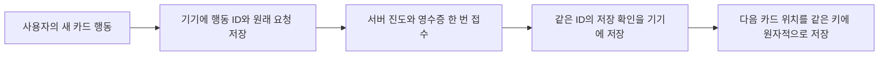

# 문자카드 진도 접수·재시도·재실행 복원 구현

2026-11-04 KST. 기준 main은 PR #230이 병합된 `42bb57c1dcb3608a9bab8fde3c875cb62b140b39`다. 사용자는 [접수 API·영수증 제약 확장안](kana-card-progress-retry-contract-proposal-2026-11-04.md)에 따른 구현, 회귀 및 시뮬레이터의 응답 유실·재시도·앱 재실행 검증을 승인했다. **운영 적용은 제외**하며 결과와 적용/원복안을 먼저 보고한다.

## 유지할 의미

가나 카드의 인트로 ‘다음’과 연습 ‘알아요’는 의도적인 학습 행동이다. 같은 글자가 두 단계에 다시 나와도 새 행동이면 새 ID를 사용한다. 응답만 확인하지 못한 같은 행동은 ID를 바꾸지 않고 재전송한다. 연습의 ‘모르겠어요’는 기존대로 진도 POST 없이 로컬 위치만 옮긴다.

새 경로는 기존 카드 진도의 `correct_count`·문자별 `streak`·일별 `kana_learned` 및 기존 일별 인정 효과를 **한 행동당 한 번** 처리한다. XP·사용자 연속일 계산·SRS·오늘 단어 목표를 새로 갱신하지 않는다. 기존 `/kana/progress`와 웹·구 클라이언트의 정책은 유지하며 과거 기록을 백필·삭제·재계산하지 않는다.

## 서버 계약과 DB 경계

- 새 `POST /api/v1/kana/progress/activities`는 `activityId`, `expectedUserId`, `kanaId`를 필수로 받는다.
- 성공200의 `{ok:true, activityId, processedAt}`는 최초 접수의 UTC 시각을 담는다. 같은 사용자·행동·내용은 저장된 원래 응답을 반환하고 추가 집계하지 않는다.
- 인증 계정 불일치는403, 같은 ID의 다른 kind/문자 내용은409, 신규 요청의 없는 문자는404, 손상된 영수증이나 확인할 수 없는 저장은503으로 다룬다. 접수된 요청은 원본 문자가 이후 바뀌거나 사라져도 영수증부터 확인한다.
- 사용자별 잠금 안에서 영수증을 확인한 뒤, 최초 카드 진도 효과와 영수증을 같은 transaction으로 commit한다. commit 전 실패는 함께 rollback한다. 원래 legacy 함수의 내부 commit을 그대로 호출하지 않고 같은 upsert/daily helper를 재사용한다.
- 기존 학습 저장 STOP 목록에도 새 경로를 추가해 같은 중지 정책을 적용한다. 운영 flag·환경 계약은 바꾸지 않는다.

새 Alembic revision `r8s9t0u1v2w3`는 `q7r8s9t0u1v2` 다음에서 기존 `study_activity_receipts.source_kind` CHECK에 `KANA_CARD_PROGRESS`만 추가한다. 테이블·컬럼·인덱스·권한·RLS·Data API 노출은 추가하지 않는다. owner·RLS·기존 제약·권한·빈 Data API 노출 경계를 확인한 뒤 바꾸고, 열/인덱스/보안 메타데이터가 그대로인지 검증한다. 새 종류의 영수증이 존재하면 downgrade로 제약을 축소하지 못하게 한다.

OpenAPI와 생성 TypeScript 타입은 새 경로·타입만 추가한다. 기존 경로/스키마를 독립 대조하고 admin·web 소비자를 검사한다. Prisma의 기존 문자열 필드는 유지하며 CHECK의 실제 DB 동기화 결과를 별도로 확인한다.

## 모바일의 기기 저장과 복원

계정·단계별 새 버전 namespace에 하나의 bounded journal을 저장한다. 기존 로그인·목표·레슨 저장 키는 사용하거나 지우지 않는다. 문자 ID/표기/순서·단계의 고정된 내용과 현재 위치를 보관하되, 학습 횟수·잠금·완료 점수 등 바뀌는 진행 값은 콘텐츠 서명에 포함하지 않는다.

prepared 기록을 기기에 저장하기 전에는 POST하지 않는다. 응답 유실 뒤에는 같은 문제·행동 ID·계정·문자를 유지한다. 저장 확인을 기기에 남긴 뒤에만 다음 위치를 저장하고 표시한다. 확인 저장이나 위치 저장이 실패하면 원래 ID/영수증을 지우지 않는다.

앱을 다시 켜면 durable prepared는 같은 ID의 명시적 재시도로 복원한다. durable ACK는 서버에 다시 보내지 않고 로컬 위치만 복원한다. 마지막 문자를 마친 quiz-ready 위치도 남겨 삭제 실패가 완료한 카드를 부활시키지 않게 한다. 복원만으로 새 퀴즈를 시작하거나 완료하지 않으며 퀴즈 시작은 사용자가 선택한다. 문자부터 다시 학습하는 새 의도와 미확인 요청의 폐기를 혼동하지 않는다.

SharedPreferences는 native 저장 결과 전에 메모리 cache를 바꿀 수 있다. reload한 값을 기준으로 읽기·CAS를 직렬화하고 false/throw 뒤에도 reload한다. 여러 store/container가 같은 prefs를 사용해도 같은 queue를 공유한다. 늦은 페이지·계정 전환·동시 탭·화면 종료·손상/내용 변경에서는 원래 기록을 보존하고 확인할 수 없는 새 요청을 보내지 않는다. 새 경로404에서도 legacy 경로로 fallback하지 않는다.

## 검증 계획

1. API 단위·실제 PostgreSQL에서 동시 요청, commit 전 실패, commit 후 응답 유실, 다른 계정·같은 ID의 다른 내용, 손상된 영수증, KST 날짜/월 경계 재전송을 검사한다.
2. 마이그레이션 전후 기존 두 영수증 종류·학습 행·권한/RLS/컬럼/인덱스 보존, 정상 upgrade/downgrade와 새 영수증 존재 시 downgrade 거부를 검사한다.
3. 모바일에서 로컬 저장 전/후 false·throw·reload 실패, prepared/ACK/위치 각 경계의 프로세스 복원, CAS 충돌·계정/내용 변경·늦은 응답과 API 미지원404를 검사한다.
4. 동기화한 OpenAPI·생성 타입·Prisma와 TypeScript 소비자를 검사한다. Python import·snapshot·테스트가 이번 작업 트리 소스를 사용했는지 확인한다.
5. 전용 iOS 시뮬레이터에서 실제 제품 페이지·SharedPreferences·localhost의 실제 새 API·격리 PostgreSQL을 연결한다. commit 후 첫 성공 응답만 잃게 한 다음, 수동 재시도와 실제 terminate→launch 후 재시도에서 같은 ID/최초 시각과 집계 한 번을 DB로 대조한다. intro/practice의 새 행동은 별도 ID로 한 번씩 인정되는지도 확인한다.

합성 메모리 adapter만으로 DB 중복 방지를 증명하지 않는다. 정상 운영 Auth·DB·설정·음원은 검증에 사용하지 않고, localhost 요청과 전용 시뮬레이터/테스트 DB만 허용한다. 실제 서버 코드의 테스트용 Auth 대체·응답 유실 장치는 비공개 로컬 harness에만 둔다.

## 운영 적용 전 순서와 원복안

이번에는 로컬 마이그레이션·구현·회귀·네이티브 검증과 draft PR까지만 진행한다. PR #230은 사용자 승인으로 병합했으나 이 새 API·DB·모바일 기능은 승인 전 운영에 병합하거나 배포하지 않는다.

운영에 적용할 때는 현재 코드/영수증 제약/보안/기존 기록을 읽기 전용으로 확인한 뒤 **CHECK 확장 → 새 API 서버 → 새 앱** 순서로 진행한다. 기존 API·앱은 유지하며 과거 백필하지 않는다. 필요한 유지보수·현재 writer 정리는 실제 운영 적용안에서 확인한다.

문제가 있으면 새 진입을 중단하고 호환 앱·서버를 원복하되 이미 받은 영수증과 확장된 제약을 남긴다. pending을 구 경로로 재전송하거나 기록을 수동 차감하지 않는다. 새 영수증이 있으면 제약 축소 downgrade를 거부한다. 이 문서는 운영 실행 승인이 아니다.

## 결과 기록

[PR #230](https://github.com/WhiteMouseDev/HaruKoto/pull/230)은 main에 병합됐고 [병합 후 CI](https://github.com/WhiteMouseDev/HaruKoto/actions/runs/41757817082)를 통과했다. 아래 검증은 그 병합 커밋을 기준으로 새 접수 기능을 추가한 작업 트리에서 진행했다.

| 검증          | 결과                                                                                                        |
| ------------- | ----------------------------------------------------------------------------------------------------------- |
| API 전체      | 1,771개 통과, 기존 관리자 fixture 의존 13개 스킵                                                            |
| 신규 API 회귀 | 위 집계에 단위 24개와 실제 PostgreSQL 23개 포함                                                             |
| 모바일 전체   | 1,407개 통과, 분석 오류 0건, Dart 파일 646개 포맷 변경 0건                                                  |
| API 계약·타입 | 기존 경로 109개와 스키마 215개 유지, 경로 1개·스키마 2개 추가. 모바일 계약 검사 및 web·admin 타입 검사 통과 |
| DB 동기화     | 격리 DB에서 r8 적용과 원복 경계 확인. Prisma 스키마 차이 없음                                               |

전용 iOS 시뮬레이터에서 실제 문자카드 화면·저장소를 격리된 FastAPI와 PostgreSQL에 연결했다. 테스트 계정으로 서버 커밋까지 실행하고 첫 성공 응답만 가렸다. 두 번 모두 실제 앱 프로세스를 종료한 뒤 새 프로세스로 열었다.

| 시점                            | 카드 진도·일별 가나 집계·영수증               |
| ------------------------------- | --------------------------------------------- |
| 시작                            | 각각 0                                        |
| 서버 커밋 직후 성공 응답 유실   | 각각 1                                        |
| 첫 앱 재실행, 재시도 전         | 각각 1. 같은 문자·행동 ID 복원, 자동 제출 0건 |
| 같은 ID로 ‘문자 저장 다시 확인’ | 각각 1. 최초 처리 시각 반환                   |
| 같은 문자의 별도 연습 저장      | 각각 2. 새 행동 ID 사용                       |
| 두 번째 앱 재실행               | 각각 2. 퀴즈 시작 전 위치 복원, 자동 제출 0건 |

합성 계정의 기존 인증·학습·복습·접수·음원 데이터와 DB 보안 메타데이터가 검증 전후 일치했다. 앱의 외부 연결 시도와 예상 밖 요청, Flutter 오류는 모두 0건이었다. 시뮬레이터는 테스트용 인증을 사용했다. 앱 재실행과 서버 응답 유실은 검증했으며, 기기 전원 손실과 운영 로그인은 이 검증 범위 밖이다. 마지막 카드의 정상 동작에서 파생된 퀴즈 시작 요청 1건은 테스트 장치에서 차단해 퀴즈 세션을 만들지 않았다.

시뮬레이터 캡처는 [재실행 후 저장 확인](../screenshots/kana-card-progress-receipts-2026-11-04/cold-pending.png), [두 번째 재실행 후 위치 복원](../screenshots/kana-card-progress-receipts-2026-11-04/final-cold-ready.png)에 보관한다. 검증한 모바일 런타임 437개와 관련 API 파일 8개를 해시로 확인했다. 합성 환경의 상세 결과 JSON SHA-256은 `feceb026a961eea4b83c44be594e09e5a0239337fb315429ff86111017a35a17`이다.
