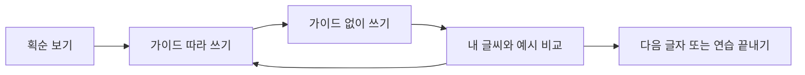

# 히라가나·가타카나 쓰기 연습 설계

2026-11-04 KST. 일본어 입문~N5 학습자를 위한 구현 전 설계다. 사용자는 쓰기 기능의 설계를 요청했으며, 이번 작업에서 쓰기 화면·자산·패키지·API·DB·보상 정책을 적용하지 않는다. 가나 저장 실패 수정과는 분리한다.

## 목표와 추천 범위

문자와 소리를 연결하고, 쓰는 순서와 방향을 익힌 뒤 가이드 없이 한 번 떠올려 쓰게 한다. 기존 읽기·듣기 학습 안의 선택 가능한 보조 연습으로 둔다. 모든 문자를 써야 N5 레슨으로 갈 수 있는 잠금 조건은 추가하지 않는다.

첫 파일럿은 `あいうえお`와 `アイウエオ`의10글자다. 검수된 획순 자산과 손가락 입력의 사용성을 확인한 뒤 기본46자씩92자로 확장한다. 이후 헷갈리기 쉬운 `シ/ツ`, `ソ/ン`, `ぬ/め` 등을 다루며, 탁음·반탁음·요음은 별도 단계로 설계한다. 현재 앱의 요음 한 항목은 `きゃ`처럼 여러 문자일 수 있으므로 기존 가나 항목을 모두 한 칸의 단일 문자로 취급하지 않는다. 확장 수량은 실제 대상 manifest로 확정한다.

권장 학습 단위는 현재 배우는 행에서3~5글자를 골라2~3분 연습하는 방식이다. 이는 제품 가설이며 사용자 평가로 조정한다. 쓰기를 잘했다는 점수가 읽기·듣기 숙련이나 JLPT 합격 수준을 뜻하지 않도록 표시한다.

## 현재 구현에서 확인한 조건

- 기존 `KanaCharacterModel`에는 문자·읽기·획 수가 있으나 획순 경로는 파싱하지 않는다. 현재 문자 상세는 글꼴 문자와 발음·예시를 표시하며, 실제 펜 입력 기능은 없다.
- API는 이미 nullable `strokeOrder: list[str]`를 반환하고 DB에도 선택 필드가 있다. 그러나 저장소의 기본 히라가나46행·가타카나46행 seed에는 `strokeOrder`가 하나도 없다. 이 확인은 로컬 seed에 대한 것이며 운영 DB의 값이 비었다고 판정한 검사가 아니다.
- 글꼴 외곽선을 순서대로 그린다고 획순이 되지는 않는다. 출력용 글꼴과 손글씨의 모양 차이, `き/さ/り` 등의 허용 변형을 일본어 교육 검수자가 확인해야 한다.
- Flutter SDK의 입력·Canvas와 기존 테마·계정 경계를 사용할 수 있다. 첫 단계에 인식 SDK나 서버 저장을 추가할 필요는 없다.

## 진입과 세 단계

가나 학습 영역에 ‘쓰기 연습’을 두고, 문자 상세에서 ‘이 글자 써보기’로도 진입한다. 기존 가나 홈과 단계 목록의 주요 읽기·듣기 행동을 밀어내지 않는다. 목표 문자를 고른 다음 아래 흐름으로 진행한다.

| 단계      | 화면과 행동                                                             | 다음 단계의 의미                                      |
| --------- | ----------------------------------------------------------------------- | ----------------------------------------------------- |
| 획순 보기 | 문자·발음, 번호와 시작점·방향, 한 획씩 재생/정지/다시 보기              | 순서와 방향을 보고 쓰기 준비                          |
| 따라 쓰기 | 연한 기준선, 현재 획 강조, 손가락/펜 입력. ‘한 획 지우기’와 ‘다시 쓰기’ | 가이드를 따라 충분히 연습함. 문자 숙련 완료 판정 아님 |
| 혼자 쓰기 | 문자 모양을 숨기고 소리·읽기를 단서로 입력. ‘예시와 비교’ 뒤 겹쳐 보기  | 사용자가 자신의 글씨를 확인하고 필요하면 다시 연습    |

한 화면에 큰 정사각형 쓰기 칸 하나를 중심으로 둔다. 상단은 뒤로가기·문자/읽기·진행 위치, 중간은 획순/입력 칸, 하단은 지우기·힌트·다음 행동으로 구성한다. 브랜드 핑크는 현재 획과 주요 버튼에 사용하고, 넓은 입력 바탕과 안내 선은 기존 중립 surface를 사용한다. 기본 크기를 줄여 전체 화면을 맞추는 대신 긴 문구·큰 글씨는 줄바꿈하고 필요하면 화면을 세로로 배치한다.

입력 칸의 실제 크기에 따라 좌표를0~1로 정규화한다. 입력이 버튼이나 다른 영역으로 번지지 않게 clip/hit boundary를 일치시킨다. 선택 중인 손가락 하나만 받고, 다중 터치·pointer cancel·화면 회전·백그라운드 전환에서 진행 중인 획을 안전하게 취소한다. 이미 확정한 획은 유지한다. 연습을 나가면 애니메이션과 발음 재생을 취소한다.

## 피드백: 안내와 판정을 구분

1차는 검수된 예시를 따라 쓰는 안내와 사용자 자기 확인을 제공한다. 좌표가 조금 다르다는 이유로 빨간 오답이나0점을 주지 않는다. 초기에는 획 수·시작 위치·대략적인 진행 방향을 부드러운 힌트로 사용하고, 허용 범위는 손가락·펜·화면 크기와 전문가가 승인한 변형으로 검증한다.

- 가이드 모드: ‘오른쪽 아래로 이어 써보세요’, ‘다음 획의 시작점을 확인해 보세요’처럼 수정할 행동을 안내한다.
- 혼자 쓰기: ‘예시와 비교해 보세요’, ‘한 번 더 써보기’, ‘다음 글자’로 진행한다. 입력하지 않은 빈 칸·아주 짧은 우발 터치는 연습한 글자로 집계하지 않는다.
- 완료: ‘3글자를 연습했어요’로 표시한다. 근거 없는97% 정확도, 자동 ‘마스터’, 기존 학습 점수·XP는 표시하지 않는다.

엄격한 획순 평가나 자동 문자 인식은 별도 실험이다. 디지털 잉크의 문자 인식 결과는 손글씨의 교육적 정확성·획순 점수와 다르다. 검수 없이 인식 confidence를 학습자의 점수로 전환하지 않는다.

## 자산과 라이선스

권장 방식은 Unicode 문자와 버전으로 찾는 검수된 로컬 획순 pack이다. DB의 문자 ID나 기존 progress와 자산의 생명주기를 묶지 않는다. 첫10자부터 아래 manifest를 만든다.

| 필드                                          | 용도                       |
| --------------------------------------------- | -------------------------- |
| 문자·Unicode·script·assetVersion              | 단일 문자 식별과 변경 감지 |
| 원본 URL·원본 commit/파일 SHA·라이선스·저작자 | 출처·허용 조건 추적        |
| viewBox·획별 순서/방향·경로·시작점            | 재생과 가이드              |
| 검수자·날짜·판정·허용 변형                    | 교육용 사용 승인           |
| 변환 도구 버전·변환 후 SHA                    | 런타임용 좌표 변환과 재현  |

직접 제작 후 검수하거나, KanjiVG 같은 획순 데이터를 후보로 삼을 수 있다. KanjiVG는 CC BY-SA3.0으로 안내되므로 실제 채택 전 정확한 파일 범위·저작자/라이선스 표기·수정 내역·배포 조건을 확인하고 해당 자산 묶음에 보존한다. 사이트의 모든 데이터가 가나92자를 원하는 형태로 제공한다고 가정하지 않는다. 현재 PR에는 외부 획순 자산을 복사하거나 생성하지 않는다.

JPF의 교재와 획순 화면은 교육 흐름의 참고 자료이며, 무료 열람을 앱 내 복제 허가로 해석하지 않는다. 앱에는 사용 권한과 검수 근거가 있는 자산만 넣는다.

## 기술·저장·학습 지표 경계

향후 구현은 `features/kana` 안의 별도 writing 페이지/컨트롤러·로컬 자산 repository로 제한한다. 기존 Flutter의 `CustomPaint`/`CustomPainter`, 포인터 이벤트, `Path`를 사용하고, 애니메이션·입력·저장을 분리한다. 정규화한 좌표를 기기 픽셀로 변환하며 획 단위로 다시 그린다. 필기 중 전체 화면을 매 이벤트 rebuild하지 않는다. SVG 원본을 샘플 점으로 변환한다면 변환 방법·해상도·라이선스·검수 내역을 함께 고정한다.

로컬 진행은 새 계정별·버전별 namespace로 분리하는 안을 권한다. 현재 글자·모드·확정한 획·연습 완료 여부만 크기 상한 안에서 직렬 저장하고, 쓰기 완료를 기다린 뒤 저장됐다고 표시한다. 원시 좌표는 현재 글자 복원에 필요한 최소한만 보관하고 서버·Sentry·분석 이벤트로 보내지 않는다. 계정 변경·로그아웃 뒤에는 이전 계정의 글씨를 숨긴다. 자산 버전 불일치·손상·저장 실패는 조용히 성공 처리하지 않고 새 연습/재시도를 안내한다. 강제 종료 전에 완료되지 않은 쓰기까지 보장하지 않는다.

1차 로컬 보조 연습은 기존 단어 목표·가나 learned/mastered·단계 해금·SRS 기한·XP·학습일에 쓰지 않는다. **쓰기 완료도 학습일로 인정하려면 별도 서버 접수·재전송 방지 정책을 먼저 설계하고 승인받아야 한다.** 필기 동작을 기존 퀴즈의 가짜 정답이나 `stage-complete` 호출로 바꿔 출석을 만들지 않는다. 이 정책 경계는 기능을 구현할 때 진입 안내와 도움말에 알기 쉽게 반영한다.

기기 간 동기화·교사의 원격 글씨 확인·이미지 업로드·필기 SRS는 별도 API/DB 제안 대상이다. Data API는 계속 차단하며 이 기능을 위해 직접 DB 접근을 열지 않는다.

## 접근성과 회귀

- 획순 번호·방향을 색에만 의존하지 않고 표현한다. 동작 줄이기 설정에서는 자동 애니메이션 대신 한 획씩 보기로 전환한다.
- 320px 화면·글자200%·가로/세로·라이트/다크에서 입력 칸과44px 이상 버튼이 겹치지 않도록 한다. 사용자의 기본 글자 크기를 강제로 축소하지 않는다.
- 왼손·오른손 모두에서 손에 가려지는 위치를 확인한다. 스크린리더로 글자·현재 획·지우기·넘기기·발음에 접근할 수 있게 하고, 선을 그릴 때마다 음성으로 알리지 않는다.
- 손가락 입력이 어려우면 관찰·발음 듣기·건너뛰기를 제공한다. 쓰기 기능의 접근성 제한으로 기존 가나·N5 학습이 막히지 않는다.
- 입력 시작/이동/종료/취소·다중 터치·경계 밖 입력·undo·지우기·빠른 재시작·백그라운드·이탈·dispose를 검증한다.
- 계정 전환·늦은 저장·저장 실패·자산 누락/손상/버전 변경·프로세스 재실행에서 이전 계정의 글씨나 잘못된 완료가 나오지 않아야 한다.
- 기존 로그인·가나 답안·퀴즈 완료·오늘 목표·연속일·복습 기한이 쓰기 연습만으로 바뀌지 않는지 부정 검사를 포함한다.

## 단계별 도입과 완료 기준

| 단계        | 산출물과 gate                                                                                              |
| ----------- | ---------------------------------------------------------------------------------------------------------- |
| 지금        | 이 설계와 출처·정책 경계. 제품 구현 없음                                                                   |
| 파일럿 준비 | 10자 획순 자산·라이선스·전문 검수, 실제 손가락 입력 프로토타입. 글꼴 문자와의 차이 포함                    |
| 선택형 MVP  | 획순→따라 쓰기→혼자 쓰기, 계정별 로컬 저장, 최소 보조 안내, 접근성·네이티브 회귀. 기존 학습 지표 변경 없음 |
| 92자 확장   | 문자별 승인과 허용 변형, 서로 헷갈리는 문자 연습, 자산 누락 없는 manifest                                  |
| 별도 제안   | 서버 학습일 인정·동기화·자동 인식 SDK·필기 복습. 변경 계약/비용/실패/롤백안을 먼저 확인                    |

파일럿에서는 입문자가 지시 없이 한 글자를 시작하고 지우고 다시 쓸 수 있는지, 손가락이 가이드를 가리는지, 다음날 가이드 없이 떠올리는 데 도움이 되는지 관찰한다. 소규모 사용성 확인을 학습 효과의 통계적 입증으로 설명하지 않는다. 읽기·듣기의 첫 학습을 지연시키지 않는지도 함께 본다.

초기 로컬 기능은 모바일 진입점과 자산 pack을 되돌리는 방식으로 원복할 수 있어야 한다. 기존 서버 기록·로그인·SRS·단어 목표·Data API를 보정할 필요가 없어야 한다. 인식 SDK·새 의존성·학습일 계약은 이번 설계의 자동 승인 대상이 아니다.

## 확인한 공식 자료

2026-11-04 확인. 아래는 제안의 참고 근거이며 우리 앱의 효과·획순 자산 전체·필기 채점 정확도를 검증한 결과가 아니다.

- [JPF Marugoto 입문 교사용 안내](https://marugoto.jpf.go.jp/assets/docs/teacher/resource/starter_c/starter_competences_teachers_notes_EN.pdf): 문자와 소리를 연결하고 획순 애니메이션·개별 연습을 안내한다. 이름 같은 실제 표현과 연결하는 접근의 참고 자료다.
- [MARUGOTO Plus 히라가나](https://a1.marugotoweb.jp/en/hiragana.php): 문자·읽기별 학습 진입의 공식 예시다. 자료를 앱에 복제하는 것은 이 설계의 범위가 아니다.
- [JLPT 시험 과목·문항 구성](https://www.jlpt.jp/e/guideline/testsections.html): N5는 어휘·문법/읽기·듣기로 구성된다. 쓰기를 읽기·듣기 진입의 필수 통과 조건으로 두지 않는 판단에 참고했다.
- [KanjiVG 공식 소개·라이선스](https://kanjivg.tagaini.net/): 획 모양·방향·순서 데이터와 CC BY-SA3.0 안내. 실제 가나 자산 범위와 채택 조건은 파일별 확인이 필요하다.
- [Flutter CustomPaint](https://api.flutter.dev/flutter/widgets/CustomPaint-class.html): 별도 인식 의존성 없이 그리기 영역을 구현할 수 있는 기존 SDK 경계다.
- [Google ML Kit Digital Ink Recognition](https://developers.google.com/ml-kit/vision/digital-ink-recognition): 좌표·시간을 가진 획을 기기에서 인식하고 언어 모델을 다운로드하는 후속 후보. 이미지 OCR과 다르며 획순 교육 점수를 제공한다는 근거로 사용하지 않는다. 지금은 SDK·모델을 추가하지 않는다.
